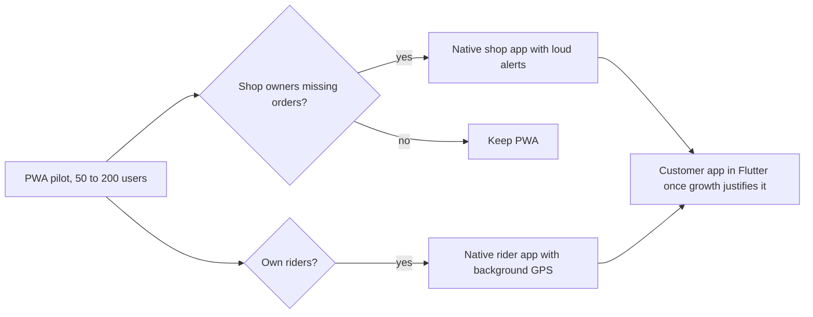

# PWA vs native for Soon

**Recommendation:** ship a PWA for the pilot. Add a native shop-owner app (and later a rider app) only when real usage proves the need.

| | PWA (what is built) | Native (Flutter or Kotlin/Swift) |
|---|---|---|
| Cost to launch | Already built; hosting ₹500 to 2,000 a month | Rebuild, roughly ₹4 to 12 lakh extra for two platforms |
| Time to first users | Today: share a link | 6 to 12 weeks, plus store review |
| Install | Add to home screen; no store, no 30% fee, no review wait | Play Store (about $25 once), App Store ($99 a year) |
| Store presence and discovery | None; customers must find the link | Searchable, builds trust |
| Updates | Instant on every deploy | Store review each time, users update slowly |
| Push notifications, Android | Works well | Works well |
| Push notifications, iPhone | Only after the user installs to home screen, iOS 16.4 or newer; less reliable | Reliable |
| Order alert for shop owners | Weak: a closed browser tab can miss orders. Needs a loud ringing alert, which is the main PWA risk | Strong: persistent alert sound, foreground service |
| Background location (riders) | Not possible when the screen is off | Fully possible |
| Offline | App shell opens offline; orders and stock need internet | Can queue actions offline |
| Performance | Good for lists and carts | Smoother animation, maps |
| Camera, contacts, biometrics | Basic camera only | Full |
| Payments | Razorpay web checkout works; UPI intent links work on Android | Native SDK, smoother UPI |
| One codebase | Yes | Flutter yes; native no |

## Why a PWA first
1. You have no dev team. One web codebase is the cheapest to maintain and change weekly.
2. A pilot needs learning speed, not store polish. Fixes reach everyone instantly.
3. Customers on Android (most of your Bengaluru audience) get a near-native experience.

## Where it will hurt
- **Shop owners missing orders** is the biggest risk. In the pilot, use a WhatsApp or SMS alert as backup, and ask owners to keep the dashboard open on a charged phone or tablet.
- **iPhone push** needs an install step many users skip. Use SMS for order updates at first.
- **Rider live tracking** will not work in the background. If you run your own riders, they need a small native app.

## Suggested path

Wrapping the PWA in Capacitor for the stores is a cheap middle step (days, not weeks), but Apple may reject thin wrappers, so only do it if you add real native features such as push.
